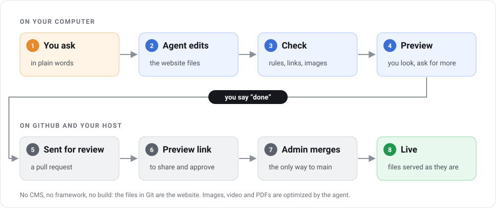

# .nib: nothing in between

A way to build websites as plain files that anyone edits by asking an AI agent. No CMS, no framework, no build:
the files in Git are the website, the agent is the editor, and the host serves the files as they are.

`.nib` holds the general rules ([AGENTS.md](AGENTS.md)), a few small scripts that need only Node.js, the setup
steps for a new computer ([setup.md](setup.md)), and a starter site ([starter/](starter/)). Each site keeps its own
rules in its `AGENTS.md` and its status and decisions in `.knowledge/`.

## Installation

Open your repo in your agent (Claude, Codex, Kimi, Cursor or any other) and give it this:

```text
Set up this repo with .nib by following https://raw.githubusercontent.com/ShiftSoftware/.nib/main/install.md
```

## How it works

**[Watch the 70-second video](guide/nib-explainer.mp4)** · [Read the explainer](https://htmlpreview.github.io/?https://github.com/ShiftSoftware/.nib/blob/main/guide/index.html)



## Changing .nib

Anyone, person or agent, can propose a change with a pull request; nothing is pushed to `main` directly. A rule
that applies to one site belongs in that site's `AGENTS.md`, not here.

## License

[Apache License 2.0](LICENSE). Copyright 2026 Shift Software.
